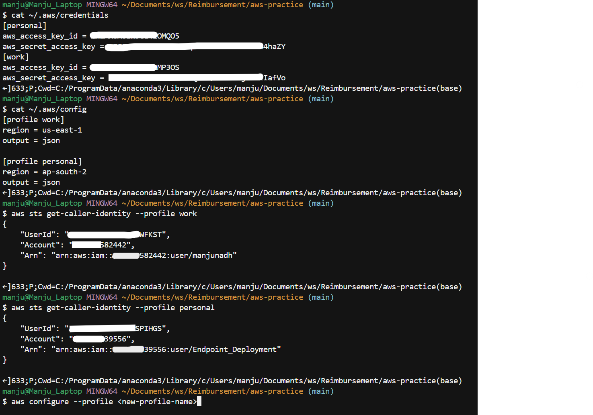
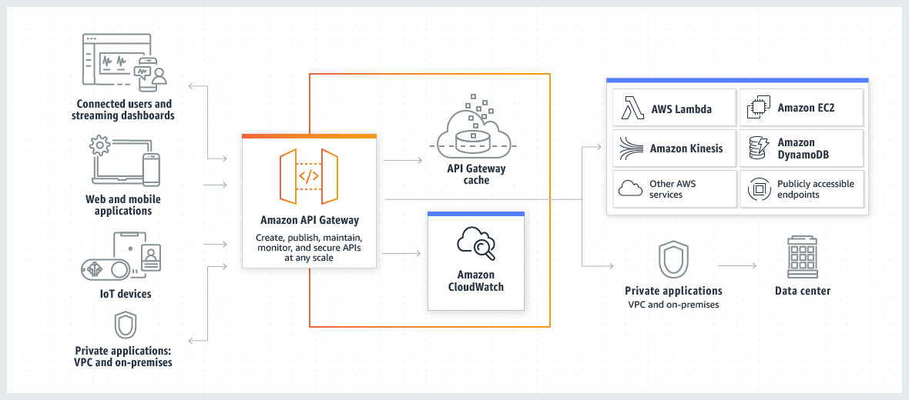

<!-- markdownlint-disable-file -->
## AWS General Notes

- Credentials can be classified into long-term permanent credentials (static) and temporary security credentials (dynamic).
- **AWS Security Token Service (AWS STS)** produce and manage these temporary security credentials.
- Temporary Security Credentials consist of an Access Key ID, a Secret Access Key, and a Session Token.

## Set up a profile per account

```bash
aws configure --profile personal
# AWS Access Key ID: <personal key>
# AWS Secret Access Key: <personal secret>
# Default region: ap-south-2 (or whatever that account uses)
# Default output: json

aws configure --profile work
# ... work account's keys ...
```

For each project, based on which profile is needed, use `export AWS_PROFILE=work` to set the profile for that terminal session.




#### Note:

- For multiple AWS accounts(work and personal for example), create profiles in `~/.aws/credentials` and `~/.aws/config` as shown in image. In the bash terminal, just export whichever aws profile is necessary using `export AWS_PROFILE=<your-profile>` and the corresponding credentials are used.
- `UserId` in aws sts get-caller-identity is AWS internal id for each AWS User, and the credentials for this id are madeup of 2 parts(aws_access_key_id, aws_secret_access_key)
- IAM (Identity and Access Management) is the central service used to securely control access to AWS resources
- **IAM user**: an identity for one person or program inside the account
  - Example: `arn:aws:iam::<aws-account-number>:user/Endpoint_Deployment`
  - `Endpoint_Deployment` is the IAM username, and we can attach AWS policies(AmazonS3ReadOnlyAccess, AmazonS3ObjectLambdaExecutionRolePolicy etc.) to it.
- **Credentials**: what a user shows to prove who they are. There are two kinds:
  - A **console password** is used to sign in on the AWS website.
  - **Access keys** are used by the CLI or code:
    - **aws_access_key_id**: public part of accesskeys
    - **aws_secret_access_key**: private part of accesskeys
- **Policy**: a rule that says what is allowed.
  - Example: AmazonS3ReadOnlyAccess, AmazonS3ObjectLambdaExecutionRolePolicy
- **Group**: Collection of users that share the same policy.
  - Example: put all interns in an Interns group that can only read S3.
- **Role**: Set of permissions that someone borrows for a short time. A role has no password or permanent keys.
  - Example: `arn:aws:iam::<aws-account-number>:role/lambda-service-role`
  - `lambda-service-role` is the role that has permissions for multiple policies like `AWSLambdaBasicExecutionRole`, `AmazonS3FullAccess` etc.
- **Amazon Resource Name (ARN)**: Unique string that identifies an AWS resource
  - Example: arn:aws:iam:::/
    - IAM-resource-type   ==> user/role/group
    - IAM-resource-name ==> username/Rolename/Groupname
- **JSON Policy Document**: JSON file that holds an IAM policy. The following are the keys in this json:

  | Field                | Meaning                                               | Example                                                         |
  | -------------------- | ----------------------------------------------------- | --------------------------------------------------------------- |
  | Version              | The policy language version. Always use "2012-10-17". | "2012-10-17"                                                    |
  | Statement            | A list of one or more rules                           | [ {...}, {...} ]                                                |
  | Effect               | Allow or Deny                                         | "Allow"                                                         |
  | Action               | What can be done, written as service:operation        | "s3:GetObject" (read a file), "s3:DeleteObject" (delete a file) |
  | Resource             | Which things the rule applies to, given as ARNs       | "arn:aws:s3:::my-bucket/*" (every file in that bucket)          |
  | Condition (optional) | Extra requirements for the rule to apply              | Only from a certain IP address, or only with MFA                |

  Example JSON Policy Document:
  
  ```json
  {
  "Version": "2012-10-17",
  "Statement": [
    {
      "Effect": "Allow",
      "Action": ["s3:GetObject", "s3:ListBucket"],
      "Resource": [
        "arn:aws:s3:::my-bucket",
        "arn:aws:s3:::my-bucket/*"
      ]
    }
  ]
  }
  ```
  
  
## AWS API Gateway:

An API (Application Programming Interface) is simply a bridge that allows two software programs to talk to each other. The terms HTTP, REST, and WebSocket describe how that bridge is built and the rules for crossing it.

  (1) **HTTP (Hypertext Transfer Protocol)** is the foundation of data exchange on the web. It is a **Request-Response** protocol.
    - **HTTP API** (often called RPC - Remote Procedure Call) is any API that uses the HTTP protocol to transfer data over the internet.
    - **How it works:** A client (like a browser) sends a request to a server, and the server sends a response back. Once the response is delivered, the connection usually closes.
    - **Direction:** Unidirectional. The client must always initiate the conversation. The server cannot "call" the client to give it data it didn't ask for.
  
  (2) **REST (Representational State Transfer)** is not a protocol, but a style or set of rules for building APIs that almost always use the HTTP protocol.
    - REST is not a replacement for HTTP. REST is a specific style of building an HTTP API. **All REST APIs are HTTP APIs, but not all HTTP APIs are REST APIs.**
    - **How it works:** REST organizes data into "Resources" (like /users or /products). It uses standard HTTP methods to act on that data:
      - GET (Read)
      - POST (Create)
      - PUT (Update)
      - DELETE (Delete)
    - **Statelessness:** This is a key rule of REST. The server doesn’t "remember" previous requests. Every single request must contain all the information needed to understand it (e.g., an API key or User ID).
  
  (3) **WebSocket** is a different protocol entirely. It provides a **persistent, two-way (full-duplex)** communication channel.

    HTTP/REST APIs are terrible at one thing: Real-time communication.
    If you are building a chat app using a REST API, your app has to constantly ask the server: "Are there new messages? Are there new messages? Are there new messages?" every single second. This is called **"polling"** and it drains batteries and overloads servers.
    WebSockets solve this. A WebSocket API uses the ws:// or wss:// protocol instead of http://.

    - **How it works:** It starts with an HTTP "handshake" to establish a connection, but then it upgrades the connection to a WebSocket. The connection stays open indefinitely.
    - **Direction:** Bidirectional. Both the client and the server can send data at any time without waiting for the other to ask. 

Amazon API Gateway is an AWS service for creating, publishing, maintaining, monitoring, and securing REST, HTTP, and WebSocket APIs at any scale.
API Gateway acts as a "front door" for applications to access data, business logic, or functionality from your backend services, such as workloads running on Amazon Elastic Compute Cloud (Amazon EC2), code running on AWS Lambda, any web application, or real-time communication applications. Its tasks include traffic management, authorization and access control, monitoring, and API version management.


AWS offers two main ways to build APIs: the older "REST API" (v1) and the newer "HTTP API" (v2).