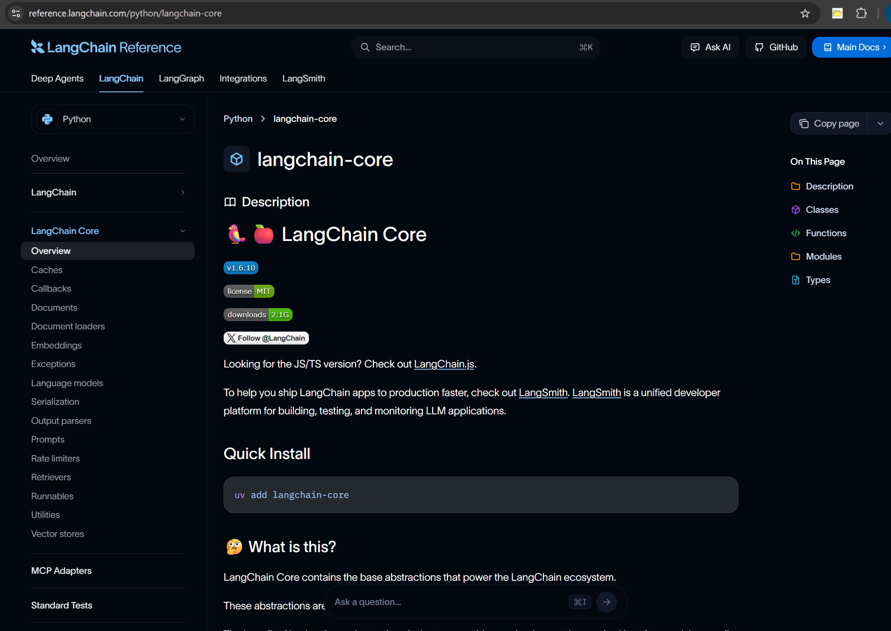
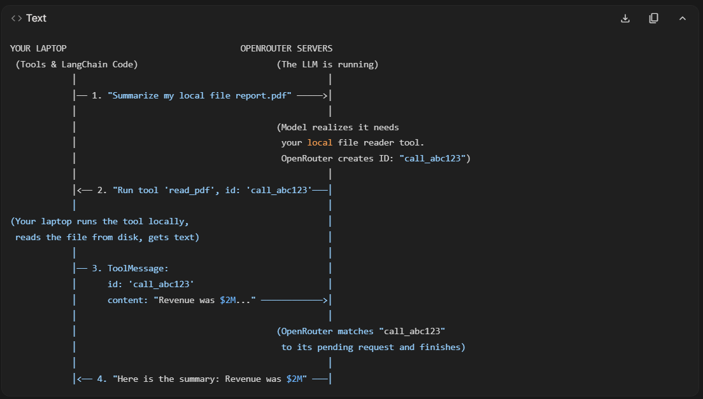

<!-- markdownlint-disable-file -->
# Langchain

- `langchain-core` is like a universal adapter and is the most basic foundational library for the entire langchain, langgraph ecosystem. All other libraries are built using it.
- `langchain-core` doesnt have any operational code and instead contains the Abstract Base Classes(template) code that all other libraries are inherited and built on.
- Main libraries like `langchain`and `langgraph` or integration libraries like `langchain-community`(contains community-maintained integrations for opensource vectorDBs, embedding models etc.), `langchain-openai`, `langchain-anthropic`, or `langchain-google-genai`(partner packages) are all built on top of `langchain-core`.
- `langchain-core` library at heart is a basic python library located at [libs/core/langchain_core](https://github.com/langchain-ai/langchain/tree/master/libs/core/langchain_core). So, each item in the sidebar below is either a directory with an __init__.py file(python package) or a standalone python file(python module) in `langchain-core` library.


**Note**:
- **Module** is the smallest piece of software(standalone .py file containing reusable fns.)
- **Package** is a collection of modules.(subdirectory in Github repo that has an `__init__.py` file)
- **Library** is a collection of packages.(main directory in Github repo)
- **Framework** is a set of libraries.(home Github repo)
- So, `langchain` is a **framework** that has a **library** called `langchain_core` that contains multiple **packages** like `language_models/` or `embeddings/` and **modules** like `chat_history.py` or `retrievers.py`

## Orchestration Types:
There are two types of orchestration in Langchain ecosystem(langchain, langgraph, langserve etc.).
1. **Linear Orchestration:**
   1. Data passes forward step-by-step (A ➔ B ➔ C).
   2. DAG (Directed Acyclic Graph) — strict one-way streets with no loops.
   3. Eg: Inputs(multimodal) -> LLM -> Output -> Tool(say email) -> Email LLM's result
   4. `runnables/` package handles this type of linear orchestration. **It has no concept of time loops or state persistence**.
   5. If LLM throws an error, error is reported back to user(if instruction is to email the result, error is emailed)
2. **Dynamic Orchestrator/ReAct (Reason + Action) Loop:**
   1. This concept is built on top of **Chain-of-Thought(CoT)** concept. Without CoT, if we give LLM a logical questionlike "John has 5 apples. He eats 2, buys 4 more, and gives half to Mary. How many does he have left?", LLM simply guesses an answer(purely based on training data), whereas with CoT, it breaks this problem into a series of intermediate, step-by-step reasoning sentences before giving the answer.
   2. The main problem with CoT is its **isolation**:
      1. **No external grounding:** Pure CoT based LLM is 100% reliant on training data, so if we ask "Which party does the PM of India belong to?", it might correctly get the reasoning sentences and give the ex-PM's party based on its training data.
      2. **No error correction:** Since CoT is linear sequence where one step is dependent on previous step, if an intermediate step is wrong(model hallucinates), the entire reasoning chain starts giving wrong answers.
      3. Pure LLMs are language engines, not computational engines. So, for a complex math problem, it might correctly breakdown the steps but an answer to a simple multiplication problem might be a guessed number(since there is no internal calculator for the LLM). 
   3. ReAct framework combines the internal "thinking" of CoT with an external "action" loop, giving the model the ability to interact with real-world environments (like Google Search, calculators, or databases).
> `langgraph` is built on top of `langchain` and is the library that handles this ReAct loop.
> `langchain` performs Linear orchestration whereas `langgraph` handles Dynamic orchestration

## Langchain Message Roles
In LangChain, interactions with chat models (like GPT-4, Claude, or Gemini) are abstracted into Message Objects. Each message has a specific role that tells the language model who is speaking and what kind of information is being passed. These roles are defined in `langchain_core.messages`.

#### Core Message Roles:

1. SystemMessage (Role: system)

 - **Purpose:** Sets the behavior, tone, constraints, and instructions for the model.
 - This messages act as "operating instructions", most models prioritise system instructions over user instructions to prevent prompt injection.
  
2. HumanMessage (Role: human)
   - **Purpose:** End-user prompt input

3. AIMessage (Role: assistant/ai)
   - **Purpose:** Response generated by LLM
    - Key Attributes:
        - **content:** The text returned by the model.
        - **tool_calls:** A list of tool invocations requested by the model (if function/tool calling is used).
        - **response_metadata:** Token usage, stop reasons, model name, etc.

#### Tool & Function Calling Roles:

1. ToolMessage (Role: tool)
    - **Purpose:** Returns the output of a tool (e.g., a database query, web search, or calculator) back to the model.
    - The AIMessage returned by the model will also contain a .tool_calls list property if the AI wants to use an external tool.
    - Key Attribute: Requires a `tool_call_id` to link the result directly to the specific tool invocation generated in a previous AIMessage. This `tool_call_id` is created by LLM provider’s inference server (e.g., OpenAI, Anthropic, Google, OpenRouter)
    

2. FunctionMessage (Role: function)
   - **Purpose:** The legacy predecessor to ToolMessage, allowed only executing one fn at a time, ToolMessage allows parallel tool calls. 

#### Generic & Custom Roles:
    
1. ChatMessage
    - **Purpose:** In Langchain, we mostly use hardcoded classes like HumanMessage, AIMessage, and SystemMessage which have unchangable roles("user", "assistant", and "system"). ChatMessages allow developers to specify an arbitrary or custom role based on the context(like customer, agent, supervisor roles when fetching past conversations from a database) or when multiple AI agents/LLMs interact like a group chat(eg. rStation which is a shared research lab concept where agents from various AI labs conduct experiments and log their results in one website that are read by newly spawned agents to make conclusions and initiate new experiments accordingly)

2. RemoveMessage
    - **Purpose:** A control message used in stateful graph workflows (like LangGraph) to explicitly mark a message for deletion from conversation memory to save context window tokens.

## Basic Steps to call LLM model
```python
# 1. Read .env file
from dotenv import load_dotenv
load_dotenv()

# 2. Initiate model connection
from langchain_openrouter import ChatOpenRouter
model = ChatOpenRouter(model="nvidia/nemotron-3-super-120b-a12b:free", temperature=0)

# 3. Define actual user input prompt
user_input = """The city council approved a plan to plant 12,000 trees across
the eastern districts over the next four years. The scheme is funded by a
levy on new commercial developments, and the first 2,000 trees will go in
along the ring road where air quality readings have been worst."""

# 4. Define a prompt template so that user's input can be injected into it
prompt_template = ChatPromptTemplate.from_messages([
    ("system", "You summarise text for busy people."),
    ("user", "Summarise this in one sentence:\n\n{text}"),
])

# 5. Inject user input into prompt template
final_prompt_message = prompt_template.invoke({"text": user_input})

# 6. Call LLM with final prompt message
response = model.invoke(messages)

# 7. Extract output text
response.text # or response.content
# or
from langchain_core.output_parsers import StrOutputParser
StrOutputParser().invoke(response)
```
these steps can be written as Chains as shown below:
#### Chaining LLM Model
```python
chain = final_prompt_message | model | StrOutputParser()
chain.invoke({"text": user_input})
```

## Langchain Repo Structure and Overview
```
libs/core/langchain_core
    |
(---------- Package ----------)
    |__ `runnables/`        : The Orchestration Backbone(Only Linear Orchestration)
    |__ `tools/`            : Define how to convert basic python fn. into an LLM compatible object(so that it understands and calls if needed) 
    |__ `messages/`         : Standardises the input and output data formats(both textual and multimodal) for Chat models irrespective of llm api vendors.
    |__ `prompts/`          : Converts raw user variables into fully structured input prompts. ChatPromptTemplate, PromptTemplate, MessagesPlaceholder are the key primitives
    |__ `documents/`        : Contains the fundamental Document class. Every single input file in a RAG project(pdf, jpg, docx etc.) is converted into one or more Document objects 
    |__ `document_loaders/` : Define BaseLoader class, the universal blueprint for converting raw files into standard Document objects. PDF file for example is processed by PyPDFLoader, which implements BaseLoader
    |__ `language_models/`  : Defines the core chat model interface "BaseChatModel" from which each model extends(ChatOpenAI, ChatAnthropic,ChatOpenRouter etc.) so that models can be switched without rewriting application logic. 
    |__ `vectorstores/`     : Provides abstract base class "VectorStore" that provides standard operations like add_documents(),similarity_search() so that Langchain can standardise vector database interaction irrespective of vector DB provider.
    |__ `embeddings/`       : Defines "Embeddings" abstract base class that model providers extend to publish their own embedding packages(eg. OpenAIEmbeddings() from langchain_openai, GoogleGenAIEmbeddings() from langchain_google_genai etc.) and implementing mandatory, universal methods embed_documents() and embed_query()
    |__ `load/`             : Provides universal serialisation(LangChain objects->JSON) and deserialisation(JSON-> LangChain objects) capabilities.
    |__ `indexing/`         : Acts as a stateful sync coordinator when user updates one of the raw input files so that re-embedding is performed only on the modified file leaving the rest as it is to prevent redundant processing and saving costs. "RecordManager" maps hashes of original documents to their corresponding generated vector IDs.
    |__ `tracers/`          : Defines "LangChainTracer" used for exposing Langchain to LLMOPS and monitoring libraries like Langsmith. 
    |__ `output_parsers/`   : Defines various output parsers like StrOutputParser() to parse and extract actual reply from AIMessage(response of LLM)
    |__ `callbacks/`        : Defines BaseCallbackHandler and CallbackManager. This package powers token streaming, logging, and real-time metrics and connects tracers/ package
    |__ `example_selectors/`
    |__ `outputs/`
    |__ `utils/`
(---------- Modules ----------)
    |__ retrievers.py
    |__ chat_history.py     : Defines abstract base class "BaseChatMessageHistory" with universal methods like add_message(), get_messages(), clear() for persisting and fetching past messages
    |__ caches.py           : Defines BaseCache, the contract for storing and retrieving previously generated LLM outputs.
    |__ rate_limiters.py    : Defines BaseRateLimiter, the contract that caps the number of requests per second (RPS)
    |__ stores.py
    |__ agents.py
    |__ prompt_values.py
```

For a basic RAG pipeline implemented using Langchain:
1. Raw PDF file(input document for RAG)
2. ➔ PyPDFLoader (extends BaseLoader from langchain_core.document_loaders)
3. ➔ Document object (defined by langchain_core.documents)
4. ➔ RecursiveCharacterTextSplitter (from the external langchain-text-splitters package, which inherits from the BaseTextSplitter abstract base class, this part is independent from langchain_core to keep the library stable, chunking needs a lot of external dependencies)
5. ➔ Multiple Document objects (smaller chunks with split text but cloned metadata)
6. ➔ OpenAIEmbeddings (from langchain_openai, which implements the Embeddings abstract base class from langchain_core.embeddings)
7. ➔ Embedding vectors stored in a VectorStore (defined by langchain_core.vectorstores)
