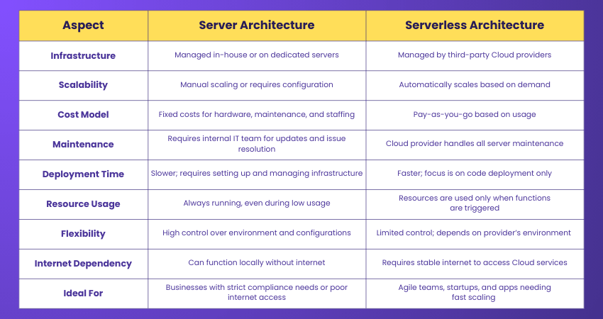

Serverless vs Server based Architectures:

Serverless manages the server on our behalf: load balancing(multiplying the servers, called horizontal scaling), dynamically changing RAM capacity(vertical scaling of RAM upto maxiumum of 10GB), pay per request and general server maintainence(updating the servers be it packages, os, security updates etc). They dont offer GPUs.

Server based architecture does the exact opposite of serverless.
Provisioned server based architecture manage servers for us like serverless but take a premium for the maintainence and horizontal scaling. The provisioned server(be it with/without GPU) charges fixed cost like server based architecture and make sure we have this machine at all times. It can vertically scale RAM like serverless and horizontally scale if demand increased. 
Sagemaker endpoints with GPUs for AI inference are this provisioned server based architecture.
Note: Serverless usually doesnt charge for very small storage(like used for storing code files) but for bigger storage, it moves it to S3(in case of AWS) and charges storage fees.

